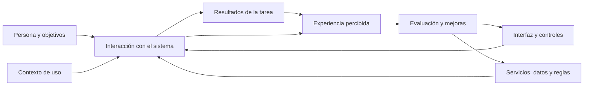

# Capítulo 01. Introducción a UI, UX y HCI

**Nivel:** Fundamental.  
**Prerrequisitos:** Ninguno.  
**Conexiones posteriores:** Cap. 02 (investigación), 03 (arquitectura de información), 04 (cognición), 05 (heurísticas), 06 (accesibilidad).  
**Resultado esperado:** Ser capaz de describir una experiencia digital como un sistema de tareas, interacciones y resultados, y distinguir problemas visuales, funcionales, informacionales, de usabilidad y de accesibilidad.

## 1.1. El error de empezar por la pantalla

Imagina que una persona ingresa a un portal educativo porque necesita descargar una constancia de matrícula. Al abrir el sitio encuentra una pantalla limpia: encabezado equilibrado, colores institucionales, iconos consistentes y animaciones discretas. Sin embargo, no existe ninguna opción llamada «Constancia de matrícula». La operación está escondida en «Gestión → Recursos → Servicios → Documentos». Tras encontrarla, el sistema muestra «Operación finalizada», sin explicar si el documento se creó, se envió por correo o quedó pendiente.

La interfaz puede ser visualmente correcta y, aun así, la experiencia resultar deficiente. El problema no se soluciona necesariamente redibujando iconos: hay que estudiar la estructura de información, las palabras elegidas, la visibilidad de la acción, la respuesta del sistema y el objetivo que la persona intentaba cumplir.

Este caso introduce la diferencia central entre **la presentación y los mecanismos de interacción** y **la experiencia que emerge al intentar satisfacer una necesidad**.

No toda buena experiencia requiere una apariencia sofisticada. Una interfaz sobria, accesible, predecible y eficaz puede ser una solución superior a otra más decorada que aumenta los pasos o dificulta el reconocimiento de acciones.

### Un mismo problema visto desde varias disciplinas

| Perspectiva | Pregunta que formula ante el caso |
|---|---|
| UI | ¿La acción es visible, distinguible y comprensible en la pantalla? |
| Arquitectura de información | ¿La persona puede deducir dónde encontrar el documento? |
| Diseño de interacción | ¿Qué ocurre al activar la acción, esperar, fallar o volver atrás? |
| Diseño de contenido | ¿La etiqueta y los mensajes comunican con precisión qué sucede? |
| Usabilidad | ¿Puede completar la tarea de forma eficaz, eficiente y satisfactoria? |
| Accesibilidad | ¿Puede hacerlo también con teclado, lector de pantalla u otras adaptaciones? |
| UX | ¿Cómo percibe y vive todo el proceso, incluido el resultado y lo que ocurre después? |
| Ingeniería | ¿La funcionalidad produce datos correctos, seguros, disponibles y recuperables? |

Estas perspectivas se solapan; no son departamentos independientes ni una cadena rígida de trabajo.

## 1.2. Qué es una interfaz de usuario (UI)

**UI (User Interface)** es la parte de un sistema mediante la cual una persona recibe información, comprende opciones y ejecuta acciones. En productos gráficos incluye controles, distribución espacial, tipografía, iconografía, color y estados visuales; también abarca elementos de interacción más allá de lo puramente visual, como el manejo del foco, el teclado y la semántica de los componentes.

Dos interpretaciones incompletas son frecuentes:

- «UI significa escoger colores y dibujar pantallas». El diseño visual es una parte de la UI, pero la interfaz también expresa estado, opciones, restricciones y comportamiento.
- «UI equivale a UX». Una UI concreta participa en la experiencia, pero no la explica completamente. Latencia, errores de negocio, disponibilidad de información y expectativas previas también influyen en la UX.

**Ejemplo.** Un botón con la etiqueta «Descargar constancia» es una pieza de UI. También lo son su estado deshabilitado, el indicador de progreso, la explicación de por qué no está disponible y la confirmación de lo que ocurrió tras activarlo. La pantalla no está diseñada por completo si solo se dibuja el botón en su estado inicial.

## 1.3. Qué es la experiencia de usuario (UX)

**UX (User Experience)** se refiere a las percepciones y respuestas de una persona asociadas con el uso o uso anticipado de un producto, sistema o servicio. La experiencia se configura antes, durante y después de la interacción. Don Norman y Jakob Nielsen destacaron que la experiencia abarca el conjunto de interacciones con productos, servicios y organización; por ello no puede reducirse a la interfaz de una sola pantalla [F1].

En el caso de la constancia académica, la experiencia puede verse afectada por varios factores:

**Antes de usar.** ¿La persona sabe que el documento está disponible? ¿Es razonable esperar que pueda obtenerlo desde el celular? ¿Recuerda cómo ingresar?

**Durante el uso.** ¿Encuentra la opción? ¿Comprende si el documento corresponde al período académico correcto? ¿Puede descargarlo sin volver a introducir información que el sistema ya conoce?

**Después del uso.** ¿El archivo abre correctamente? ¿Tiene el contenido esperado? ¿Se informa claramente si requiere validación institucional? ¿Puede encontrarlo otra vez?

Una experiencia positiva no se demuestra con una calificación estética ni con el hecho de que la operación exista en el menú. Hay que observar el recorrido completo y sus consecuencias para las personas usuarias.

### UX como experiencia y UX como disciplina

Conviene distinguir dos usos del término. **UX como fenómeno** es lo que las personas efectivamente experimentan. **Diseño UX como práctica profesional** reúne métodos para investigar, modelar, mejorar y evaluar esa experiencia. Un equipo puede hacer actividades de UX y aun así entregar una mala experiencia; el uso de un método no garantiza el resultado [F2].

## 1.4. Qué es HCI y cómo se vincula con UI/UX

**HCI (Human–Computer Interaction)**, o interacción persona-computadora, es un campo interdisciplinario que estudia cómo las personas interactúan con sistemas informáticos y cómo diseñar y evaluar esas interacciones. Integra conocimientos de informática, psicología, ergonomía, ciencias cognitivas, diseño y otras disciplinas.

En términos prácticos, HCI ayuda a plantear preguntas como: ¿cuánto esfuerzo exige identificar una acción?, ¿cómo cambia el desempeño con la práctica?, ¿qué ocurre cuando el sistema responde tarde?, ¿cómo influyen la capacidad motriz y el contexto de uso?, ¿cómo detectar un error antes de que cause consecuencias?

No debe interpretarse como una jerarquía matemática en la que «HCI contiene UX y UX contiene UI» en todos los sentidos. Son conceptos y ámbitos de trabajo con distintos alcances, métodos y objetivos. El diagrama siguiente representa sus relaciones funcionales, no una clasificación formal de subconjuntos:



La calidad final depende de la colaboración entre investigación, diseño e ingeniería.

## 1.5. Usabilidad: eficaz, eficiente y satisfactoria para quién y en qué contexto

La norma **ISO 9241-11:2018** plantea la usabilidad en términos de la capacidad de usuarios especificados para lograr objetivos especificados con **eficacia, eficiencia y satisfacción**, en un **contexto de uso especificado**. La ficha oficial confirma que trata definiciones y conceptos de usabilidad, no un proceso de diseño prescrito [F3].

Las palabras «usuarios», «objetivos» y «contexto» son esenciales. No existe una única evaluación de usabilidad independiente de quién utiliza el sistema y para qué.

**Eficacia.** Grado en el que se alcanza el objetivo de manera correcta y completa. Descargar el archivo equivocado no cumple el objetivo, aunque la descarga técnica haya terminado sin errores.

**Eficiencia.** Recursos necesarios para obtener el resultado; pueden incluir tiempo, esfuerzo, pasos, carga mental o costos operativos, según el estudio.

**Satisfacción.** Percepción y respuesta de la persona durante y después del uso, evaluada mediante instrumentos apropiados. No debe inferirse automáticamente a partir del tiempo o número de clics.

### Ejemplo de métricas

En una prueba hipotética, ocho participantes intentan descargar una constancia. Seis obtienen el documento correcto sin ayuda; los otros dos no completan la tarea. La **tasa de finalización correcta observada** sería:

\[
\text{Tasa de éxito} = \frac{6}{8} \times 100 = 75\%.
\]

Este 75 % es **un dato ilustrativo ficticio**, no una medida real de una plataforma. No permite, por sí solo, conocer la causa de los fallos ni generalizar a toda una población. Sería necesario revisar tareas, participantes, incidencias, posibles sesgos y condiciones de prueba.

Del mismo modo, el tiempo medio de finalización debería calcularse y reportarse con una regla explícita: ¿se incluyen intentos fallidos?, ¿se reportan por separado?, ¿qué ocurre con quienes solicitan ayuda? Sin esa definición, dos cifras de «tiempo promedio» pueden no ser comparables.

### Cinco atributos útiles, sin confundirlos con la definición ISO

Nielsen Norman Group también caracteriza la usabilidad mediante facilidad de aprendizaje (*learnability*), eficiencia, memorabilidad, errores y satisfacción [F4]. Son dimensiones útiles para analizar una interfaz; no conviene presentarlas como sustitución literal de la formulación de ISO 9241-11.

Para un sistema administrativo de uso diario, podría ser crucial la eficiencia después del aprendizaje. Para un formulario de matrícula que una familia completa una vez al año, cobra mayor importancia el desempeño en el primer uso y la capacidad de retomar el proceso tras meses de inactividad.

**Consecuencia práctica:** no optimices un producto solo para el usuario experto si gran parte de sus usuarios son ocasionales.

## 1.6. Accesibilidad, inclusión y usabilidad: relación sin equivalencias falsas

La **accesibilidad** busca que las personas con discapacidad puedan percibir, comprender, navegar e interactuar con herramientas y contenidos digitales. La **usabilidad** aborda la eficacia, eficiencia y satisfacción en las tareas. El **diseño inclusivo** considera además la diversidad de circunstancias, capacidades, recursos y contextos. Son objetivos relacionados, pero no idénticos [F5].

Ejemplo: colocar una etiqueta visible y programáticamente asociada a un campo ayuda a usuarios que ven la pantalla y a quienes utilizan lectores de pantalla. Sin embargo, un formulario puede cumplir ciertos criterios técnicos de accesibilidad y continuar siendo demasiado largo, confuso o difícil de completar. A la inversa, que una prueba con usuarios sin discapacidad salga bien no demuestra que el formulario sea accesible.

La recomendación de este manual es abordar accesibilidad desde el inicio, incluir personas con necesidades diversas en las pruebas y verificar criterios normativos pertinentes. Las **WCAG 2.2** definen criterios verificables de accesibilidad web con niveles A, AA y AAA [F6]; no certifican por sí solas que toda la experiencia sea satisfactoria.

La conformidad WCAG para una página web se evalúa respecto de la página completa y sus variaciones, no de un control aislado que funciona correctamente [F6].

## 1.7. Arquitectura de información, interacción, visual y contenido

Estos conceptos suelen confundirse porque todos participan en una misma pantalla. Conviene separarlos analíticamente:

**Arquitectura de información (IA).** Organiza conceptos, secciones, relaciones, navegación y formas de encontrar contenido. En nuestro ejemplo, determina si la constancia debe pertenecer a «Mis documentos», «Trámites» u otra estructura basada en el lenguaje y las expectativas de quienes usan el sistema.

**Diseño de interacción (IxD).** Define la respuesta del producto a las acciones y la secuencia de eventos: activar «Consultar», mostrar espera, presentar el resultado, permitir reintento o cancelar una solicitud.

**Diseño visual.** Establece jerarquía, tipografía, espacio, color y otras propiedades de presentación para comunicar prioridades y relaciones.

**Diseño de contenido (content design / UX writing).** Define los textos y su relación con las tareas. «Documento generado» y «Tu constancia está disponible para descargar» no expresan exactamente lo mismo; el segundo comunica mejor una acción posible cuando esa disponibilidad es real.

**Diseño de servicio.** Considera la experiencia más allá de una pantalla: aprobación institucional, disponibilidad del documento, notificaciones, asistencia, entrega y procedimientos que pueden involucrar personas u otros sistemas.

En muchos productos, mejorar una experiencia requiere cambiar simultáneamente varias de estas capas. No se resolverá un problema de información con un color de botón distinto si la causa es que el documento ni siquiera existe en el sistema.

## 1.8. Objetivos, tareas, soluciones y restricciones

El diseño de calidad comienza distinguiendo lo que una persona **quiere lograr** de la interfaz que el equipo **propone construir**.

| Concepto | Ejemplo del caso |
|---|---|
| Necesidad | Disponer de una constancia de matrícula válida. |
| Objetivo | Obtener la constancia del período lectivo correspondiente. |
| Tarea | Localizar la constancia, comprobar sus datos y descargarla. |
| Solución propuesta | Un acceso directo desde «Mis documentos». |
| Restricción | El documento puede no estar emitido o requerir autorización. |
| Resultado esperado | Archivo correcto, identificable, disponible y comprensible. |

El error frecuente consiste en redactar la necesidad como una solución («necesitamos un botón azul en Inicio»). Esa frase no explica el objetivo, el problema real ni por qué la ubicación y el color serían adecuados.

**Reformulación útil:** «Las familias necesitan acceder a su constancia sin contactar a soporte. Queremos comprobar si un acceso identificado en la sección de documentos reduce los intentos fallidos y las consultas de ayuda, sin comprometer privacidad ni exactitud». Es una hipótesis de trabajo mejor formulada, no una mejora todavía demostrada.

## 1.9. Caso práctico completo: encontrar y consultar una constancia

### Escenario

Una persona representante accede desde un teléfono de gama media, con una conexión variable. Su objetivo es consultar el estado de su constancia de matrícula correspondiente al período actual. No conoce el nombre interno del módulo donde el equipo desarrollador almacenó el recurso.

### Alternativa A: organizada desde la lógica interna

La navegación presenta «Servicios» → «Gestión» → «Recursos» → «Emisión». Al completar el recorrido aparece la leyenda «Proceso exitoso» y un botón «Aceptar». La pantalla carece de nombre del documento, período y una acción clara para continuar.

Es un **ejemplo inventado de diseño problemático**, no una evaluación real de una plataforma. Los riesgos de esta propuesta son: terminología ambigua, exceso de exploración, incertidumbre acerca del resultado y dificultad para reconocer si se completó la tarea.

### Alternativa B: organizada alrededor de la tarea

Una sección «Mis documentos» muestra «Constancia de matrícula», el período correspondiente y un estado explícito. Cuando el documento está disponible, presenta «Ver constancia». Si no está listo, comunica «Pendiente de emisión» y ofrece una explicación o un canal de seguimiento adecuado. Se preserva el contexto del documento después de regresar desde el detalle.

Esta alternativa expresa mejor la tarea, pero sigue siendo **una hipótesis de diseño**, no una garantía de que funcionará. Su éxito depende de que las familias entiendan el término, encuentren la sección, reconozcan el período y reciban información correcta del backend.

### Comparación

| Aspecto | Alternativa A | Alternativa B |
|---|---|---|
| Lenguaje | Nombres internos y genéricos | Nombre de documento reconocible |
| Orientación | Recorrido de varias secciones | Categoría asociada con la tarea |
| Estado | «Proceso exitoso» ambiguo | Disponible / pendiente / error con significado |
| Identificación | Documento o período omitidos | Documento y período visibles |
| Recuperación | Continuación incierta | Acción o explicación contextual |
| Evidencia faltante | No se ha probado con usuarios | Tampoco se ha probado todavía |

Abre `ejemplos/comparacion-ui-ux.html` para explorar una comparación visual local y funcional. El ejemplo está deliberadamente simplificado y **no consulta una API**.

### Cómo comprobar la hipótesis

Define una tarea neutral: «Encuentra la constancia de matrícula correspondiente al período 2026–2027 e indica su estado». No digas a los participantes «haz clic en Mis documentos», porque eso revelaría la solución.

Registra si se llega al documento correcto sin ayuda, tiempo por tarea con un criterio uniforme, errores de interpretación, pasos inesperados y comentarios. Incluye usuarios ocasionales y al menos escenarios relevantes de accesibilidad. Compara alternativas de forma controlada cuando el tamaño y el método de investigación lo permitan. No declares una «mejora del 40 %» sin datos reales y un denominador verificable.

## 1.10. Del diseño a la implementación: la semántica importa

Es útil mostrar desde este capítulo que diseño e ingeniería se afectan mutuamente. El siguiente fragmento utiliza elementos HTML nativos y nombres de acciones explícitos:

```html
<section aria-labelledby="documents-title">
  <h2 id="documents-title">Mis documentos</h2>

  <article aria-labelledby="enrollment-title">
    <h3 id="enrollment-title">Constancia de matrícula</h3>
    <p>Período lectivo 2026–2027</p>
    <p>Estado: disponible</p>
    <a href="/documentos/constancia-matricula">
      Ver constancia de matrícula
    </a>
  </article>
</section>
```

**Qué hace bien este ejemplo:** establece títulos reconocibles, comunica el período y el estado mediante texto, y utiliza un enlace para acceder a otro recurso. **Qué no garantiza:** que la ruta exista, que el documento corresponda a la persona autenticada, que la respuesta del servidor sea segura, que haya manejo de errores o que el estilo final satisfaga todos los criterios de accesibilidad. Estos aspectos se diseñan y verifican por separado.

**[GUÍA]** Usar elementos HTML semánticos de forma apropiada favorece una representación comprensible para el navegador y las tecnologías asistivas. Para los campos de entrada, por ejemplo, MDN señala que `placeholder` no sustituye a la etiqueta `label`, porque desaparece y puede no ser anunciado adecuadamente [F7]. Este asunto se desarrollará en el capítulo 16.

### Una representación equivalente en Flutter

La siguiente variante reducida utiliza un elemento de lista para comunicar el estado y navegar al detalle mediante `Navigator`. El archivo `ejemplos/main.dart` desarrolla el mismo caso con una tarjeta y un selector de estados; no se ha ejecutado en este entorno.

```dart
ListTile(
  title: const Text('Constancia de matrícula'),
  subtitle: const Text(
    'Período 2026–2027 · Disponible',
  ),
  trailing: const Icon(Icons.chevron_right),
  onTap: () {
    Navigator.of(context).push(
      MaterialPageRoute<void>(
        builder: (_) => const DocumentDetailPage(),
      ),
    );
  },
)
```

El ejemplo supone que `DocumentDetailPage` existe y que el estado procede de datos fiables. En el archivo completo se proporciona una implementación mínima ejecutable. En una aplicación real también se comprobarían autorización, estados de espera, fallo, disponibilidad, foco y navegación accesible.

## 1.11. No hay un diseño «mejor» sin un contexto definido

Considera dos perfiles:

**Perfil 1. Usuario ocasional.** Ingresa una vez al año para completar una matrícula. Necesita acciones reconocibles, instrucciones claras y señales de progreso. La memorización de rutas resulta poco útil porque transcurre demasiado tiempo entre sesiones.

**Perfil 2. Operador habitual.** Trabaja cada día registrando cientos de movimientos. Puede necesitar atajos de teclado, navegación eficiente entre campos y una alta densidad de información. El exceso de confirmaciones podría ralentizarlo, aunque operaciones irreversibles continúan requiriendo controles adecuados al riesgo.

Una navegación minimalista puede ser apropiada para la primera persona y poco eficiente para la segunda. Esto no significa que deban existir dos productos completamente distintos, sino que las decisiones deben considerar tareas, frecuencia, riesgos, tecnología y capacidades.

En software educativo, sanitario o financiero, un error no es solo una molestia estética. Puede afectar trámites, decisiones o datos importantes. Cuanto mayor sea el impacto de una operación equivocada, mayor debe ser la atención prestada a prevención, claridad, confirmación y recuperación.

### Trade-offs: decisiones con costos

Una interfaz visualmente simple puede ocultar opciones y exigir mayor exploración. Una interfaz densa puede acelerar el trabajo experto y dificultar el primer uso. Las animaciones pueden ayudar a comunicar continuidad, pero también distraer o afectar a personas sensibles al movimiento. Mostrar confirmaciones puede prevenir acciones peligrosas, pero interrumpir innecesariamente tareas seguras y repetitivas.

Por ello este manual no aplicará «menos es más» como un mandato absoluto. La regla será: **eliminar complejidad que no aporta valor, sin ocultar información o controles que sí resultan necesarios para completar la tarea**.

## 1.12. Primer procedimiento de diagnóstico UI/UX

Antes de modificar una pantalla existente, realiza un diagnóstico breve basado en una tarea real:

1. **Identifica a la persona y su objetivo:** quién necesita hacer qué y por qué.
2. **Especifica el contexto:** dispositivo, frecuencia, experiencia, conectividad, idioma, accesibilidad y posibles consecuencias de fallar.
3. **Recorre la tarea de principio a fin:** incluye entrada, ejecución, espera, fallos, resultado y regreso.
4. **Separa síntomas y causas posibles:** «tardan en encontrarlo» no prueba que el color sea inadecuado; puede ser un problema de estructura o terminología.
5. **Registra hipótesis y evidencia:** distingue lo observado de lo que sospechas.
6. **Propón la mínima intervención razonable:** modifica el componente, la estructura o el comportamiento que realmente origina el problema.
7. **Define cómo se comprobará:** éxito, tiempo, errores, comprensión, accesibilidad y efectos no deseados.

No todos los proyectos requieren el mismo volumen de investigación, pero todos deberían conservar una explicación verificable de por qué se decidió cambiar algo.

## 1.13. Ejercicio de aplicación

**Situación:** una app muestra un botón llamado «Procesar» al final de un formulario. Tras pulsarlo, aparece un indicador de carga durante varios segundos y luego la pantalla se cierra. El usuario no sabe si la solicitud se registró y a veces vuelve a enviarla.

**Tu trabajo:** identifica el objetivo de la persona; enumera al menos tres explicaciones posibles del problema; distingue qué pertenece a UI, interacción, UX e ingeniería; plantea una mejora sin suponer que la petición se completó; especifica al menos dos pruebas para evaluar el resultado.

### Una solución orientativa

El objetivo no es «presionar Procesar», sino registrar una solicitud correctamente y conocer su estado. Una posible mejora incluye un nombre de acción explícito, prevención de envíos duplicados mientras la operación está pendiente, resultado confirmado por la respuesta fiable del servidor y un identificador o mecanismo de seguimiento. Si la conexión falla, el sistema debe diferenciar «no enviado», «estado desconocido» y «registrado» según la evidencia disponible.

Esta propuesta no justifica mostrar «Solicitud enviada» antes de confirmar que el servidor la recibió. Tampoco resuelve por sí sola idempotencia, persistencia y seguridad, que pertenecen a la implementación integral del proceso.

## 1.14. Lista de verificación del capítulo

Al concluir, comprueba que puedes responder con ejemplos propios:

- ¿En qué difieren UI, UX, HCI, usabilidad y accesibilidad?
- ¿Por qué una interfaz bonita puede resultar poco útil?
- ¿Qué papel cumplen usuario, objetivo y contexto en la definición de usabilidad?
- ¿Cómo distingues necesidad, tarea, solución y restricción?
- ¿Por qué un estudio con ocho personas no equivale a una afirmación universal?
- ¿Qué debe mostrar el sistema cuando una operación está pendiente o falla?
- ¿Cómo explicas una decisión de diseño sin basarte solo en preferencias estéticas?

**Criterio de dominio:** formular un diagnóstico del caso práctico con una hipótesis explícita, una propuesta justificable y un modo razonable de evaluarla.

## 1.15. Relaciones con los capítulos siguientes

- **Capítulo 02 — Investigación de usuarios:** cómo obtener evidencia sobre personas, tareas y expectativas sin inventarlas.
- **Capítulo 03 — Modelos mentales y arquitectura de información:** por qué algunas rutas y etiquetas resultan reconocibles y otras no.
- **Capítulo 04 — Psicología cognitiva:** qué mecanismos explican la atención, la decisión y el esfuerzo mental.
- **Capítulo 05 — Heurísticas:** cómo inspeccionar sistemáticamente posibles problemas de interacción.
- **Capítulo 06 — Accesibilidad:** cómo diseñar y comprobar que distintas personas pueden usar el producto.

---

# Referencias verificadas de esta entrega

**[F1]** Don Norman y Jakob Nielsen. *The Definition of User Experience (UX).* Nielsen Norman Group. https://www.nngroup.com/articles/definition-user-experience/

**[F2]** Kate Kaplan. *What Is User Experience (and What Is It Not)?* Nielsen Norman Group, 2024. https://www.nngroup.com/articles/what-is-user-experience/

**[F3]** ISO. *ISO 9241-11:2018 — Ergonomics of human-system interaction — Part 11: Usability: Definitions and concepts.* Ficha oficial; revisión y confirmación en 2023. https://www.iso.org/standard/63500.html

**[F4]** Jakob Nielsen. *Usability 101: Introduction to Usability.* Nielsen Norman Group, 2012; revisión de 2026. https://www.nngroup.com/articles/usability-101-introduction-to-usability/

**[F5]** W3C WAI. *Accessibility, Usability, and Inclusion.* https://www.w3.org/WAI/fundamentals/accessibility-usability-inclusion/

**[F6]** W3C. *Web Content Accessibility Guidelines (WCAG) 2.2.* https://www.w3.org/TR/WCAG22/

**[F7]** MDN Web Docs. *HTML placeholder attribute.* https://developer.mozilla.org/en-US/docs/Web/HTML/Reference/Attributes/placeholder

**[F8]** ISO. *ISO 9241-210:2019 — Human-centred design for interactive systems.* Ficha oficial; revisión y confirmación en 2025. https://www.iso.org/standard/77520.html

**[F9]** NIST. *Human Centered Design (HCD).* https://www.nist.gov/itl/iad/human-centered-technologies/human-factors-human-centered-design

**[F10]** Jakob Nielsen. *10 Usability Heuristics for User Interface Design.* Nielsen Norman Group, 1994; revisión de 2024. https://www.nngroup.com/articles/ten-usability-heuristics/

**Observación editorial:** Las referencias están ligadas al contenido de esta entrega. En próximos capítulos se citarán fuentes especializadas adicionales y se consignarán versiones de plataformas o componentes cuando puedan afectar una implementación.

---

**Fin del Capítulo 01 (primera entrega).**


