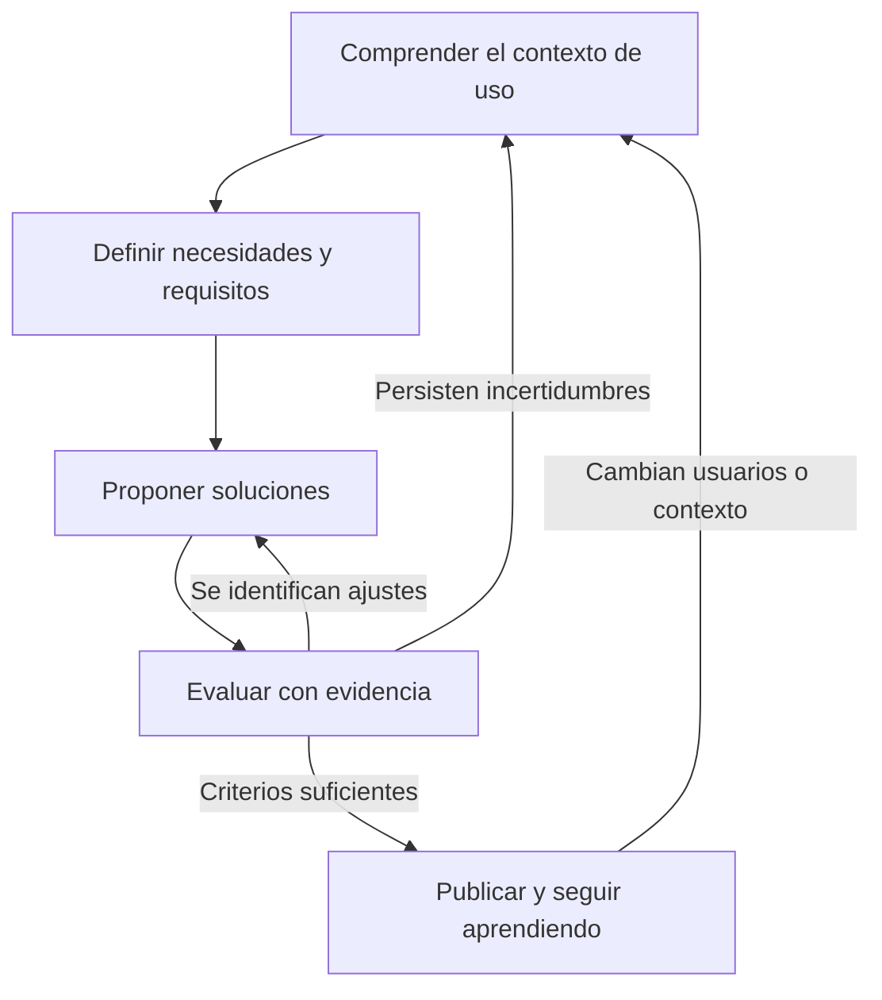
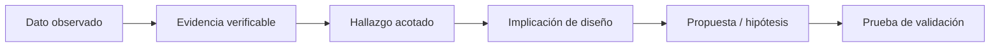

# Capítulo 02. Investigación de usuarios y diseño centrado en las personas

**Parte I · Fundamentos científicos, conceptuales y metodológicos**  
**Nivel:** Fundamental–intermedio.  
**Prerrequisito:** Capítulo 01.  
**Lecturas relacionadas:** Capítulo 03 (tareas y arquitectura de información), 05 (heurísticas), 06 (accesibilidad), 21 (navegación), 23 (formularios), 33 (prototipado y pruebas) y 36 (métricas y auditoría).  
**Resultados de aprendizaje:** formular preguntas de investigación verificables; seleccionar métodos según la incertidumbre; reclutar participantes pertinentes; conducir entrevistas sin inducir respuestas; distinguir observación, interpretación e hipótesis; producir hallazgos trazables; proteger a los participantes; y transformar evidencia en decisiones de producto.

> **Idea rectora:** investigar usuarios no es preguntarles qué interfaz les gustaría. Es obtener evidencia suficientemente fiable acerca de qué intentan lograr, cómo trabajan, qué les impide avanzar y bajo qué condiciones usan el sistema.

## 2.1. El problema de diseñar a partir de suposiciones

Una plataforma educativa recibe una petición: «Necesitamos un botón para que las familias descarguen los certificados más rápido». El equipo podría ejecutar la solicitud literalmente: agregar un botón visible en la página de inicio, asignarle un icono y considerarlo resuelto. Pero detrás de esa petición podrían existir problemas muy diferentes:

- El certificado existe, pero su ubicación no coincide con el vocabulario de las familias.
- La búsqueda funciona, pero se usa una cuenta equivocada cuando una persona representa a varios estudiantes.
- El certificado depende de una aprobación y la plataforma no comunica su estado.
- La descarga ocurre, pero algunos usuarios no saben dónde encontrar el archivo en su teléfono.
- El problema se manifiesta solo con conexiones inestables, tecnologías asistivas o dispositivos compartidos.

Estas explicaciones son **hipótesis, no hechos**. Elegir cualquiera antes de investigar puede producir una interfaz vistosa que no elimina la causa del problema.

La diferencia entre diseñar por intuición y diseñar con evidencia no significa prescindir de la experiencia profesional. Significa emplearla para formular mejores preguntas, proponer alternativas y decidir qué incertidumbres son suficientemente importantes como para investigarlas.

| Afirmación inicial | ¿Qué sabemos realmente? | Pregunta investigable |
|---|---|---|
| «Los representantes no entienden el módulo». | Hay una percepción de dificultad, pero no conocemos la tarea ni la causa. | ¿En qué paso y ante qué información se detienen? |
| «Hay que poner un botón más grande». | Existe una solución propuesta, no un diagnóstico. | ¿Los participantes localizan la acción y pueden activarla? |
| «Todos quieren recibirlo por WhatsApp». | No consta la distribución de preferencias ni las restricciones de privacidad. | ¿Cómo reciben, almacenan y comparten hoy sus documentos? |
| «El problema es que no saben usar tecnología». | Es una atribución sobre las personas sin evidencia. | ¿Qué terminología, estados o decisiones de la interfaz provocan errores? |

**[CRITERIO EDITORIAL]** Antes de implementar una solicitud de UI, registrar: problema declarado, evidencia disponible, supuestos, consecuencias de equivocarse y prueba mínima que permitiría tomar una decisión más informada.

## 2.2. Diseño centrado en las personas: qué establece ISO 9241-210

**ISO 9241-210:2019** trata principios y actividades de diseño centrado en las personas a lo largo del ciclo de vida de los sistemas interactivos. Su ficha oficial describe requisitos y recomendaciones sobre el proceso, no reglas de color, tipografía ni composición de pantallas [C02-F01]. La norma es aplicable tanto a proyectos nuevos como a la evolución de productos existentes.

En este manual sintetizamos el proceso operativo mediante cuatro actividades estrechamente relacionadas:

1. **Comprender y especificar el contexto de uso.** ¿Quién utilizará el producto?, ¿qué tareas realizará?, ¿con qué dispositivos, conocimientos, apoyos y restricciones?
2. **Especificar requisitos centrados en las personas.** ¿Qué resultados y condiciones debe permitir el sistema?, ¿qué barreras no son aceptables?
3. **Producir soluciones de diseño.** Explorar flujos, contenido, componentes y prototipos acordes con los requisitos.
4. **Evaluar las soluciones frente a los requisitos.** Observar si las personas pueden cumplir sus objetivos y actualizar lo que aún no sabemos.

Las cuatro actividades se retroalimentan. Un prototipo puede revelar un requisito omitido; una sesión de observación puede mostrar que el público inicialmente definido era incompleto; una implementación puede obligar a revisar restricciones. Por ello el enfoque es **iterativo**, no una cascada rígida en la que la investigación termina antes de escribir código.



**[NORMA / ALCANCE]** La descripción anterior es una síntesis pedagógica del enfoque. No constituye una reproducción completa de ISO 9241-210 ni una certificación de conformidad. Para invocar cumplimiento formal, deben consultarse sus requisitos íntegros y la edición aplicable.

## 2.3. Usuario, cliente, actor y parte interesada no son sinónimos

En productos institucionales suele pagar una organización mientras otras personas realizan el trabajo. Los términos deben separarse:

- **Usuario directo:** interactúa con la interfaz para cumplir una tarea. Ej.: un docente registra notas.
- **Usuario indirecto o afectado:** recibe consecuencias del sistema aunque no ejecute esa operación. Ej.: un estudiante cuya calificación depende de lo registrado.
- **Cliente o comprador:** contrata o financia el producto. Ej.: una institución.
- **Administrador y soporte:** configuran, autorizan, corrigen o atienden incidentes; también son usuarios, con tareas propias.
- **Parte interesada (*stakeholder*):** cualquier actor con intereses legítimos o responsabilidades relevantes, incluidas áreas legales y de seguridad.

Escuchar solo al comprador deja fuera a quienes padecerán errores en el uso cotidiano. Escuchar únicamente a usuarios frecuentes puede dejar fuera a nuevos usuarios o personas que dejaron de utilizar el servicio.

### Unidad de análisis: persona + tarea + contexto

Un mismo ser humano puede comportarse de manera diferente según la tarea. Un representante que consulta tareas todos los días puede tener dificultades para completar una matrícula anual. Una docente experta puede dominar la carga de calificaciones, pero no un trámite administrativo poco frecuente.

La unidad de estudio no debe ser «un usuario promedio» abstracto, sino el conjunto **quién realiza qué, bajo qué condiciones y con qué consecuencias**. El contexto incluye dispositivo, conectividad, entorno físico, idioma, experiencia previa, apoyos disponibles, presión de tiempo y riesgos de error.

## 2.4. Qué preguntas responde cada tipo de investigación

No basta con elegir entre «entrevista» o «encuesta». Las metodologías se diferencian por al menos tres ejes descritos por Nielsen Norman Group: **actitud frente a conducta**, **cualitativo frente a cuantitativo** y **contexto de la interacción** [C02-F02]. A esto conviene sumar el momento de decisión y el grado de madurez del producto.

| Dimensión | Pregunta | Ejemplos | Precaución |
|---|---|---|---|
| Actitudinal | ¿Qué piensa, recuerda o declara la persona? | Entrevistas, encuestas. | Las respuestas no sustituyen la conducta observada. |
| Conductual | ¿Qué hace realmente? | Observación, tareas de usabilidad, registros de eventos. | La conducta requiere interpretación contextual. |
| Cualitativa | ¿Cómo y por qué ocurre algo? | Entrevistas abiertas, observación contextual. | Una muestra pequeña no estima porcentajes poblacionales. |
| Cuantitativa | ¿Con qué frecuencia o magnitud ocurre? | Encuestas correctamente muestreadas, analítica y estudios de tareas con métricas. | La selección y definición de métricas condicionan la validez. |
| Generativa / descubrimiento | ¿Cuál es el problema o necesidad? | Investigación contextual, entrevistas sobre experiencias pasadas. | No confundir solicitudes de funciones con necesidades. |
| Evaluativa | ¿Esta alternativa permite completar la tarea? | Pruebas de usabilidad, experimentos. | No evaluar solo satisfacción declarada. |

**Ejemplo:** una entrevista puede revelar que una persona tiene miedo de «dañar» la matrícula si retrocede; una prueba de usabilidad puede mostrar que busca repetidamente un botón «Guardar borrador»; la analítica puede mostrar cuántas sesiones quedan incompletas. Son piezas complementarias, no respuestas intercambiables.

### Matriz rápida de selección

| Incertidumbre principal | Método prioritario | Método complementario |
|---|---|---|
| No comprendemos una necesidad | Entrevistas sobre experiencias reales | Observación de contexto |
| No conocemos el proceso fuera de pantalla | Observación contextual | Diario de actividades |
| No sabemos si encuentran una sección | *Tree testing* o prueba de tareas | Entrevistas posteriores |
| Las personas no completan un formulario | Prueba de usabilidad moderada | Analítica de pasos y errores |
| Queremos medir prevalencia en una población | Encuesta con muestreo diseñado | Análisis de sesgo/no respuesta |
| Queremos comparar dos variantes | Experimento controlado, si es viable | Investigación cualitativa sobre el resultado |
| Queremos evaluar accesibilidad real | Pruebas con usuarios con discapacidad | Evaluación WCAG por especialistas |

**No se debe diseñar la investigación comenzando por la técnica favorita del equipo.** Primero se define la decisión a tomar y después se elige la evidencia necesaria.

## 2.5. Formular un problema, una hipótesis y una pregunta de investigación

Un problema bien enunciado se refiere a una situación observada o documentada, no a la ausencia de una función inventada:

- **Débil:** «Hace falta agregar un botón de descarga».
- **Mejor:** «Algunas familias no logran obtener una constancia sin solicitar ayuda».
- **Más preciso, si está sustentado:** «En tickets de soporte de septiembre, varias solicitudes se refieren a la localización de la constancia; no sabemos si el origen es navegación, permisos o disponibilidad».

**Problema ≠ hipótesis ≠ pregunta ≠ solución.**

| Elemento | Ejemplo |
|---|---|
| Observación inicial | Se reciben consultas repetidas por la descarga de documentos. |
| Hipótesis H1 | La etiqueta actual no coincide con el vocabulario del público. |
| Hipótesis H2 | La operación depende de un estado de aprobación que no se comunica. |
| Pregunta P1 | ¿Qué palabras usan las familias para describir el documento? |
| Pregunta P2 | ¿Qué ocurre cuando intentan descargarlo y aún no está habilitado? |
| Decisión posible | Renombrar navegación, explicar estados o corregir la lógica de disponibilidad, según los hallazgos. |

Un objetivo operativo sería: «Identificar las principales barreras que impiden a representantes obtener el documento correcto desde el teléfono y priorizar una solución verificable». Debe definirse también qué resultados llevarían a **no cambiar la interfaz**: por ejemplo, si la causa demostrada fuera un proceso institucional externo.

### Registro de supuestos

Antes de investigar, conviene listar supuestos con su impacto y evidencia. No hay una puntuación universal obligatoria; una matriz sencilla puede considerar *incertidumbre*, *riesgo* y *coste de equivocarse*. Prioriza las afirmaciones que, de ser falsas, provocarían trabajo innecesario o consecuencias graves.

## 2.6. Planificar una investigación pequeña pero rigurosa

Según el Service Manual de GOV.UK, una ronda de investigación debería definir objetivos, supuestos, participantes, actividades, consentimientos, logística y tiempo para análisis [C02-F03]. El formato puede ocupar una sola página en proyectos pequeños.

**Plan resumido — ejemplo ficticio**

| Campo | Decisión |
|---|---|
| Problema | Dificultad para obtener una constancia académica. |
| Decisión pendiente | Cambiar navegación, lenguaje, estados o procedimiento. |
| Población | Representantes que solicitan constancias; soporte como actor complementario. |
| Segmentación | Uso frecuente/ocasional; Android/iOS/web; distintos niveles de familiaridad. |
| Métodos | 6 entrevistas exploratorias y 6 pruebas de tareas como punto de partida ajustable. |
| Reclutamiento | Diferentes instituciones y patrones de uso, sin limitarse a quienes ya reclamaron. |
| Evidencia adicional | Tipos de tickets anonimizados y eventos agregados disponibles. |
| Riesgos | Datos académicos, terceros visibles en pantalla, dispositivos compartidos. |
| Protección | Datos sintéticos; consentimiento específico; acceso limitado a notas. |
| Resultados esperados | Hallazgos trazables, alternativas priorizadas y plan de validación. |

**Los números son una decisión de planificación ilustrativa, no un tamaño muestral universal.** Se revisan al observar diversidad, repetición de hallazgos, riesgos y necesidad de inferencia estadística.

La plantilla editable se entrega en `plantillas/plan_investigacion.md`.

## 2.7. Reclutamiento y muestreo: encontrar a las personas correctas

Un estudio puede estar perfectamente moderado y, aun así, fallar si selecciona a personas que no representan los contextos pertinentes.

### Muestreo intencional para descubrir mecanismos

En estudios cualitativos, es habitual reclutar según características relevantes para la pregunta: frecuencia de uso, tipo de tarea, acceso, experiencia, condiciones de discapacidad, casos exitosos y fallidos. No implica representatividad estadística; pretende abarcar variabilidad útil.

En nuestro caso, una muestra formada únicamente por personal de soporte no describiría cómo interactúan familias nuevas. Una muestra formada solo por personas que completaron la descarga excluiría barreras que impidieron llegar al resultado.

### Encuestas y representatividad

Un enlace de encuesta enviado únicamente dentro de la app llega principalmente a quienes pueden entrar, leen el aviso y deciden responder. Es probable que omita a personas sin acceso, con bajas competencias digitales o que abandonaron el producto. La OCDE advierte que los medios de contacto y la no respuesta generan sesgos de selección que no desaparecen automáticamente con muchas respuestas [C02-F04].

**[EVIDENCIA]** Una muestra grande obtenida por autoselección no adquiere representatividad solo por aumentar el número de respuestas.

### ¿Cinco participantes son suficientes?

La recomendación popular de alrededor de cinco participantes se refiere a determinadas **rondas de pruebas cualitativas de usabilidad orientadas a descubrir problemas**, no a toda entrevista, encuesta, estudio de accesibilidad o prueba cuantitativa. Nielsen Norman Group enfatiza que la investigación para estimar métricas de población requiere muestras y diseño distintos [C02-F05].

- En un estudio **exploratorio**, se ajusta el reclutamiento a la diversidad de situaciones y a la aparición de nueva evidencia.
- Para **comparar tasas o estimar porcentajes**, se necesita un plan estadístico con margen de error, confianza, variación y selección apropiada.
- En **accesibilidad**, importa la diversidad de tecnologías asistivas y estrategias; una sola persona no representa a todas las demás [C02-F06].

No se impondrá un «N mágico» válido para todos los casos.

## 2.8. Entrevistas: descubrir experiencias sin poner respuestas en boca del participante

Una entrevista de investigación no es una demostración comercial, una reunión de requisitos ni una votación sobre pantallas. Nielsen Norman Group la caracteriza como un método para comprender experiencias, necesidades, valores y motivaciones de usuarios [C02-F07].

### Preguntas útiles y preguntas sesgadas

| Evitar | Preferir | Por qué |
|---|---|---|
| «¿Te gustaría un botón rápido para descargar?» | «Cuéntame la última vez que necesitaste ese documento». | Evita orientar hacia una solución. |
| «¿Fue confuso nuestro sistema?» | «¿Qué esperabas que ocurriera en ese punto?» | Evita etiquetar la experiencia por adelantado. |
| «¿No crees que tres pasos son demasiados?» | «¿Cómo decidiste qué hacer después?» | Busca conducta y razonamiento en vez de aprobación. |
| «¿Siempre revisas las notificaciones?» | «Piensa en la última notificación: ¿qué hiciste con ella?» | Reduce generalizaciones y sesgo de recuerdo. |

### Guion recomendado

1. **Apertura:** explicar propósito, duración, participación voluntaria, tratamiento de datos y eventual grabación; verificar consentimiento.
2. **Contexto:** «¿Con qué dispositivo acostumbras consultar información académica?».
3. **Último episodio real:** «¿Cuándo fue la última vez que necesitaste una constancia? ¿Cómo lo resolviste?».
4. **Profundización:** «¿Qué te hizo elegir esa opción?», «¿Qué sucedió después?», «¿Hubo alguna alternativa?».
5. **Contraste:** pedir que relate un episodio con resultado diferente, si existe.
6. **Cierre:** «¿Hay algo importante que no te pregunté?»; aclarar qué ocurrirá con los datos y recordar los mecanismos acordados para retirarse.

El moderador debe escuchar, evitar completar frases, tolerar silencios e indagar hechos concretos. Si se presenta una interfaz y se observa su uso, debe distinguirse ese segmento como **prueba de tareas**, aunque ocurra en la misma sesión.

## 2.9. Observación contextual: lo que una entrevista no puede revelar

Una persona puede afirmar que «descargar un certificado es fácil», pero durante la observación cambiar de aplicación, buscar en el correo, preguntar a un familiar y reenviarse el archivo. La observación contextual permite estudiar el flujo real, incluidos atajos, herramientas externas y restricciones del entorno [C02-F08].

**Procedimiento sugerido:** acordar una tarea cotidiana; obtener permisos; observar sin intervenir de forma innecesaria; anotar acciones y condiciones; preguntar al final por comportamientos que requieran explicación; distinguir hechos de inferencias.

**Ejemplo de registro:**

| Momento | Observación literal | Interpretación provisional |
|---|---|---|
| 10:04 | Participante abre «Comunicaciones». | Esperaba encontrar el certificado allí. |
| 10:05 | Vuelve y entra a «Repositorio». | La categorización podría ser ambigua. |
| 10:07 | Pregunta si el archivo llegará al correo. | El destino o estado de entrega podría ser poco claro. |

El registro de observación no debe afirmar «no entiende» si solo se observó una navegación alternativa. **La conducta es el dato; la explicación es una hipótesis que debe contrastarse.**

### Otras técnicas de descubrimiento

- **Estudios de diario:** las personas registran episodios durante días o semanas; útiles para tareas poco frecuentes o distribuidas en el tiempo; sensibles a abandonos y memoria.
- **Análisis de soporte:** agrupa problemas reportados; útil para detectar temas, pero no mide prevalencia entre quienes nunca contactan soporte.
- **Analítica de uso:** aporta secuencias y eventos; sin contexto no revela por qué alguien se detuvo.
- **Talleres de co-diseño:** producen ideas y lenguaje con participantes; no garantizan que la solución ideada funcione.

## 2.10. Encuestas: medir opiniones y características con cuidado

Las encuestas sirven para describir respuestas de una población o muestra, comparar segmentos y detectar patrones actitudinales. No son una alternativa barata universal a entrevistas u observación.

**Buenas prácticas:** definir la población objetivo; reclutar por un procedimiento explícito; formular preguntas neutras y de una sola idea; ofrecer opciones exhaustivas cuando sea pertinente; no exigir datos sensibles innecesarios; evitar escalas inconsistentes; probar el cuestionario antes de publicarlo; reportar no respuestas y canal de distribución.

**Mal planteada:** «¿Qué tan rápida y fácil es nuestra excelente plataforma?» mezcla atributos y sugiere la respuesta. **Mejor:** «Durante la última ocasión en que buscaste un documento, ¿lograste encontrarlo?» con opciones definidas y una pregunta independiente para dificultades experimentadas.

Si se usa una escala de 1 a 5, deben identificarse ambos extremos y mantener la dirección consistente. Una media numérica de una muestra de conveniencia puede resumir lo observado, pero no justifica inferir un promedio de toda la población.

### Ejemplo de encuesta mínima sin recolección real

1. ¿Has intentado obtener una constancia en los últimos seis meses? (Sí / No / No recuerdo).
2. Si lo intentaste, ¿cuál fue el resultado? (Obtuve el documento correcto / Otro documento / No pude obtenerlo / No recuerdo).
3. ¿Desde qué dispositivo realizaste el último intento? (Teléfono / Computadora / Tableta / Otro).
4. ¿Qué dificultad experimentaste? (Respuesta abierta, opcional).

Este cuestionario es solo una plantilla de partida; antes de aplicarlo deben revisarse su validez, flujo condicional, accesibilidad y consentimiento. El archivo HTML de esta entrega **no registra ni transmite respuestas de personas**; es un laboratorio local para diseñar estudios.

## 2.11. De datos dispersos a hallazgos defendibles

La investigación produce notas, episodios, frases, capturas, registros y estadísticas. El desafío no es acumularlos, sino convertirlos en interpretaciones que permitan tomar decisiones sin confundir certeza y posibilidad.

El proceso descrito por GOV.UK recomienda extraer observaciones, agruparlas por temas, sintetizar hallazgos y decidir acciones; también sugiere analizar los resultados con varias personas del equipo para reducir sesgos individuales [C02-F09].

**Cadena de trazabilidad:**



### Ejemplo: evidencia frente a conclusión apresurada

**Dato ficticio:** en una prueba de tareas, cuatro participantes buscaron inicialmente la constancia en «Mis documentos»; la sección real se llamaba «Servicios institucionales». Dos lograron encontrarla sin ayuda y dos necesitaron indicaciones.

**Inferencia débil:** «El 50 % de todos los representantes no sabe utilizar la plataforma».

**Hallazgo defendible:** «En esta prueba cualitativa, dos de cuatro participantes no localizaron la constancia sin ayuda. Los cuatro buscaron inicialmente en una sección con una etiqueta diferente; la estructura y el vocabulario son candidatos a revisión». La redacción conserva límites de muestra y contexto.

**Hipótesis de mejora:** utilizar un nombre reconocible para el documento y ubicarlo donde el público espera encontrarlo.

**Cómo validarla:** realizar una prueba comparativa de localización con participantes pertinentes y comprobar tasa de finalización, errores y rutas recorridas; diseñar un estudio cuantitativo si se requiere estimar impacto poblacional.

### Matriz de hallazgos

| ID | Observación | Fuentes | Hallazgo | Confianza | Acción siguiente |
|---|---|---|---|---|---|
| H-01 | Se busca el documento en otras secciones. | P-01, P-02, P-04 | Posible desajuste de vocabulario. | Media; evidencia limitada. | Probar alternativas de denominación. |
| H-02 | Se interpreta «Procesado» como «Disponible». | P-03 y soporte S-02 | Un estado podría comunicar disponibilidad erróneamente. | Baja–media; pendiente de contraste. | Revisar reglas y mensajes con equipo técnico. |

Los IDs anteriores son datos inventados para demostrar trazabilidad. El nivel de confianza no es una probabilidad matemática; documenta calidad, diversidad y consistencia de las evidencias de forma cualitativa. Mantener una **evidencia contradictoria** es igualmente importante: si alguien encontró el documento sin dificultad, registrar qué experiencia o condición lo explica.

## 2.12. Personas, segmentos y arquetipos: útiles solo si proceden de datos

Una *persona* es una representación compuesta de un patrón de necesidades, comportamientos y contextos relevante para diseñar. No debe confundirse con una fotografía, una edad arbitraria y una biografía inventada.

**Ejemplo didáctico, no una persona validada:**

> **Arquetipo provisional: representante con tareas esporádicas.** Ingresa al sistema unas pocas veces por período para trámites específicos. Necesita reconocer rápidamente el documento correcto, distinguir si está disponible y obtener una confirmación inequívoca. Puede usar un dispositivo compartido y no recordar el camino utilizado meses atrás. **Origen:** hipótesis del equipo hasta contrastar con investigación.

Una ficha de persona basada en evidencia debería documentar: patrón de tareas, objetivo principal, frecuencia, condiciones, dificultades, estrategias, fuentes, fecha, segmentos donde aplica y grado de confianza.

**Errores frecuentes:** inventar características demográficas irrelevantes; creer que una persona representa a «todas las madres» o «todos los docentes»; describir deseos sin ejemplos reales; fijar una persona que nunca se revisa; usar categorías estereotipadas de edad o discapacidad.

El uso efectivo de personas también es un asunto de ingeniería de requisitos: un estudio de profesionales publicado en 2024 identificó diferencias de uso y desafíos al trasladar personas a procesos reales de desarrollo [C02-F10]. Por eso el artefacto solo merece mantenerse si ayuda a decidir.

## 2.13. Jobs to Be Done: entender el progreso que la persona busca

El enfoque **Jobs to Be Done (JTBD)** pone el énfasis en el resultado que una persona intenta conseguir dentro de una situación. Puede complementar a las personas: estas ayudan a describir patrones de usuarios y contextos; JTBD ayuda a explicar la motivación de una tarea [C02-F11].

Una formulación práctica es:

> **Cuando** [contexto y situación], **quiero** [progreso o acción necesaria], **para** [resultado importante].

**Ejemplo:** «Cuando una institución me pide una constancia de matrícula para un trámite, quiero obtener un documento vigente y verificable desde mi teléfono, para presentarlo sin depender de atención presencial».

Esta formulación es mejor que «quiero un botón azul», porque no presupone el mecanismo. Podría resolverse con una descarga, una vista de verificación o un envío seguro, dependiendo de requisitos y restricciones que aún deben comprobarse.

**Precaución:** JTBD no demuestra por sí solo qué solución funciona; necesita investigación y evaluación. Tampoco sustituye a la definición de actores, permisos o contextos de accesibilidad.

## 2.14. Segmentación: diferenciar necesidades sin fragmentar el producto

Segmentar significa agrupar personas o situaciones por características **relevantes para una decisión de diseño**, no necesariamente por edad o cargo.

Para una plataforma educativa, algunos ejes plausibles de segmentación son:

- **Frecuencia de uso:** primera vez, uso ocasional, uso cotidiano.
- **Responsabilidad:** consulta de información, captura de datos, aprobación, administración.
- **Complejidad:** un estudiante o varios; una institución o múltiples entidades.
- **Condiciones de uso:** móvil compartido, conexión intermitente, tecnologías asistivas.
- **Experiencia técnica:** familiaridad con una tarea concreta, no «nivel digital» genérico.

Una persona puede pertenecer simultáneamente a varios segmentos. El objetivo no es fabricar veinte versiones de la UI, sino identificar qué necesidades pueden compartirse y cuáles requieren adaptación.

**Regla:** no convertir segmentos derivados de una muestra cualitativa en proporciones poblacionales, ni inferir discapacidad, situación económica o capacidades a partir de estereotipos.

## 2.15. Ética, consentimiento y protección de participantes

La investigación con personas puede generar riesgos si se graban pantallas con datos de estudiantes, se publican citas reconocibles o se presiona a alguien a participar. El Service Manual de GOV.UK exige, para sus investigaciones, consentimiento informado y explica qué información debe comunicarse antes de participar [C02-F12]. Se toma como guía metodológica, no como sustitución de la legislación ecuatoriana ni de la evaluación jurídica del proyecto.

### Información mínima a comunicar

1. Quién realiza la investigación y para qué.
2. Qué actividad se realizará, su duración y qué datos se recogerán.
3. Si habrá grabaciones, observadores o servicios externos de transcripción.
4. Cómo se almacenará, utilizará, compartirá y eliminará la información.
5. Que participar es voluntario y cómo detenerse o solicitar la retirada según las condiciones informadas y obligaciones aplicables.
6. Un canal de contacto para dudas o derechos.

**[CRITERIO EDITORIAL]** La participación en investigación no debe condicionarse a recibir un servicio institucional ordinario; hay que prevenir relaciones de presión entre docentes, instituciones, estudiantes, familias y personal administrativo.

### Minimización de datos

Para estudiar si se encuentra un certificado, normalmente no hace falta recopilar números de cédula, calificaciones, diagnósticos, direcciones o documentos reales. Utiliza cuentas de prueba, datos sintéticos y escenarios ficticios. Separa información de contacto del contenido de la investigación. Evita enviar grabaciones o transcripciones identificables a servicios externos sin base y autorizaciones apropiadas. Define tiempos de conservación y responsabilidades.

La orientación de GOV.UK sobre privacidad recomienda recopilar solo información necesaria y prestar especial atención a datos sensibles y datos relativos a menores [C02-F13].

### Investigación con niñas, niños y adolescentes

La investigación en entornos educativos puede involucrar menores de edad. En tales casos, los procedimientos deben adaptarse a edad, comprensión, consentimiento de representantes o responsables según el marco aplicable, asentimiento del menor y medidas de protección. El Department for Education del Reino Unido ofrece guías específicas sobre bienestar, salvaguardas y participación activa de niños y jóvenes [C02-F14].

No asumiremos que el consentimiento de una institución sustituye automáticamente a todas las autorizaciones necesarias ni que los requisitos de otro país sean directamente exigibles en Ecuador. La regla operativa es realizar una revisión ética y jurídica local antes de estudiar a menores o tratar datos sensibles.

## 2.16. Accesibilidad de la propia investigación

Una investigación excluyente produce conclusiones incompletas. Si las sesiones exigen necesariamente videollamada, teclado físico, visión normal o lectura rápida, es posible que queden fuera personas relevantes para el producto.

**Preparaciones recomendadas:** información y consentimiento en formatos accesibles; canales alternativos de comunicación; pausas; espacio físico accesible; tiempo suficiente; respeto por tecnologías asistivas; preguntas comprensibles; posibilidad de evitar grabaciones innecesarias; y reclutamiento de participantes con distintas estrategias de interacción.

W3C WAI recomienda incluir personas con discapacidad durante todo el proyecto y recuerda que ninguna persona representa por sí sola a todo un grupo; además, las pruebas con usuarios **complementan pero no reemplazan** la evaluación de conformidad con WCAG [C02-F06].

Ejemplo: si una persona que usa lector de pantalla no encuentra el botón, registrar la secuencia observada, plataforma, lector, dispositivo y contexto; no concluir inmediatamente que «todos los lectores fallan». El diagnóstico puede requerir inspeccionar orden de foco, semántica del control o comportamiento de la tecnología asistiva.

## 2.17. Sesgos y amenazas a la validez

**Sesgo de confirmación:** buscar evidencia que respalde la solución que el equipo ya eligió. *Control:* formular hipótesis alternativas y registrar resultados que las contradicen.

**Sesgo de selección:** estudiar solo a personas fáciles de reclutar o muy comprometidas con el producto. *Control:* considerar quién falta y por qué.

**Sesgo de cortesía o deseabilidad social:** participantes dicen que todo está bien ante quien desarrolló el sistema. *Control:* preguntas neutrales, moderadores que no defiendan el producto y observación real.

**Sesgo de recuerdo:** las personas reconstruyen incorrectamente episodios pasados. *Control:* solicitar episodios recientes y contrastar con registros apropiados.

**Efecto de observación:** saber que se está siendo observado puede cambiar la conducta. *Control:* explicar la sesión, permitir familiarización y considerar métodos en contexto real.

**Confusión por variables externas:** cambios de red, permisos, experiencia o datos pueden explicar una diferencia aparente entre interfaces. *Control:* documentar condiciones y, en experimentos, controlar factores relevantes.

### Cuatro preguntas de control

- ¿Qué evidencia contradice nuestra interpretación?
- ¿Qué grupos o situaciones no estudiamos?
- ¿Una explicación alternativa encaja igual de bien con lo observado?
- ¿Qué decisión cambiaríamos si este hallazgo resultara falso?

Responder estas preguntas mejora el rigor incluso cuando el equipo tiene poco presupuesto.

## 2.18. Caso práctico integrado: investigar la descarga de una constancia

**Todos los datos de este caso son ficticios y solo tienen propósito educativo.** No describen hallazgos reales de ningún producto.

### Paso A. Definir incertidumbre

El equipo observa solicitudes de soporte acerca de constancias. No conoce las causas. Plantea tres hipótesis: H1, terminología confusa; H2, estado del documento mal comunicado; H3, descarga terminada pero archivo difícil de localizar.

### Paso B. Planificar y reclutar

Organiza entrevistas breves con representantes de uso esporádico y frecuente, incorpora distintas condiciones de dispositivo y accesibilidad, y prepara cuentas de prueba sin datos reales. Los criterios de inclusión se vinculan al objetivo de la tarea, no solo a disponibilidad.

### Paso C. Observar tareas

Se propone un escenario neutral: «Necesitas presentar una constancia de matrícula vigente. Usando esta cuenta de prueba, intenta obtenerla». El moderador no dice qué menú contiene el archivo. Si la sesión permite preguntas, se registran por separado las indicaciones dadas.

### Paso D. Registrar evidencias

| Participante | Evidencia sintética | Hipótesis relacionada |
|---|---|---|
| P-01 | Buscó primero en «Documentos». | H1 |
| P-02 | Interpretó «Generado» como disponible para descarga. | H2 |
| P-03 | Descargó el archivo, pero buscó un mensaje sobre dónde se guardó. | H3 |
| P-04 | Encontró la acción sin ayuda. | Evidencia contraria a una dificultad universal |

No se obtiene una «tasa de problemas del 75 %». Se identifican mecanismos plausibles para probar, porque cada fila describe situaciones diferentes y el número de observaciones es deliberadamente pequeño.

### Paso E. Decidir intervenciones

- **Para H1:** preparar denominaciones alternativas y probar su capacidad de localización antes de modificar toda la navegación.
- **Para H2:** verificar primero las reglas reales del backend; después diferenciar «En proceso», «Disponible» y «No disponible» sin inventar estados.
- **Para H3:** ofrecer un mensaje posterior consistente con el comportamiento de cada plataforma, evitando afirmar que el archivo está en una ruta desconocida.

### Paso F. Validar y documentar

Realizar tareas con la variante revisada, registrar errores y ayuda requerida, comparar condiciones equivalentes y contrastar con las hipótesis originales. Si el cambio afecta documentos sensibles, incorporar revisión de autorizaciones y accesibilidad. Un hallazgo sin responsable, decisión ni prueba futura corre el riesgo de convertirse en una nota archivada.

## 2.19. Código aplicado: instrumentación de eventos sin registrar datos sensibles

La investigación conductual puede apoyarse en telemetría limitada y autorizada. La siguiente estructura de ejemplo en **Dart** muestra cómo registrar eventos de tarea **sin** incluir nombres, cédulas, identificadores de estudiantes ni contenido del documento. La integración concreta con un proveedor de analítica debe respetar permisos, políticas de privacidad y configuración de consentimiento aplicable.

```dart
/// Ejemplo conceptual para una aplicación Flutter/Dart.
/// No envía información a ningún servicio.
enum ResultadoTarea { completada, fallida, abandonada }

class EventoTarea {
  final String nombreTarea; // Vocabulario cerrado, p. ej. 'descargar_constancia'
  final ResultadoTarea resultado;
  final int duracionMilisegundos;

  const EventoTarea({
    required this.nombreTarea,
    required this.resultado,
    required this.duracionMilisegundos,
  });

  Map<String, Object> toSafeMap() => {
        'tarea': nombreTarea,
        'resultado': resultado.name,
        'duracion_ms': duracionMilisegundos,
      };
}

void registrarLocalmente(EventoTarea evento, {required bool permitido}) {
  if (!permitido) return;
  // Un repositorio real aplicaría límites, controles de acceso y retención.
  final registro = evento.toSafeMap();
  assert(!registro.containsKey('cedula'));
  // En este ejemplo, no se transmite ni persiste el registro.
}
```

Este fragmento **no constituye una implementación de producción**: no cubre almacenamiento seguro, retención, agregación, concurrencia, obligaciones legales ni amenazas de reidentificación. Incluso un conjunto de eventos aparentemente anónimos puede volverse identificable al combinarse con otros datos. Además, los eventos solo dicen *qué ocurrió en el sistema instrumentado*, no necesariamente *qué experimentó la persona*.

El paquete incluye `ejemplos/c02_analisis.py`, un ejercicio reproducible con CSV sintético que separa eventos observados de inferencias y calcula únicamente medidas descriptivas del conjunto de práctica. El capítulo 36 estudiará diseño formal de métricas, intervalos de confianza y pruebas cuantitativas.

## 2.20. Laboratorio visual: distinguir hechos, interpretaciones y decisiones

La demostración `ejemplos/c02_laboratorio.html` presenta una pequeña investigación simulada con cuatro momentos:

1. **Pregunta:** elegir qué se necesita aprender antes de elegir una técnica.
2. **Evidencia:** revisar registros observacionales ficticios.
3. **Interpretación:** diferenciar una conclusión exagerada de un hallazgo limitado a la muestra.
4. **Acción:** decidir qué hipótesis de diseño probar sin presentarla como confirmada.

El laboratorio funciona localmente, sin servidor, almacenamiento ni transferencia de datos. Su valor está en practicar la distinción entre observar, explicar y decidir, no en simular resultados estadísticos válidos.

### Ejercicio individual

Lee el siguiente caso: «Tres usuarios abandonaron un formulario cuando apareció la sección de datos del representante». Escribe:

1. **Dos explicaciones rivales** que no atribuyan el problema a incapacidad de los participantes.
2. **Un método** para averiguar qué sucedió y por qué.
3. **Una observación neutral** que registrarías durante la sesión.
4. **Una métrica** que estudiarías después, distinguiendo su denominador y limitaciones.
5. **Una decisión que todavía no tomarías** por falta de evidencia.

Una respuesta razonable podría considerar la complejidad de los campos, el desconocimiento de información requerida o el temor a compartir datos. La investigación podría combinar observación de tareas y entrevistas posteriores. No bastaría con cambiar el color del botón «Continuar».

## 2.21. Lista de verificación del capítulo

Marca cada punto solo si puedes justificarlo con un ejemplo:

- [ ] Diferencio una necesidad real, una solicitud de funcionalidad, una hipótesis y una solución.
- [ ] Conozco el papel y alcance de ISO 9241-210.
- [ ] Sé distinguir usuarios directos, afectados, compradores y otras partes interesadas.
- [ ] Puedo elegir métodos actitudinales/conductuales y cualitativos/cuantitativos según una decisión pendiente.
- [ ] Elaboro preguntas de entrevista que no conduzcan artificialmente a una respuesta.
- [ ] Documento criterios de reclutamiento y grupos no incluidos.
- [ ] No convierto muestras cualitativas pequeñas en porcentajes poblacionales.
- [ ] Mantengo trazabilidad entre observación, hallazgo, recomendación y validación.
- [ ] Identifico sesgos e hipótesis rivales.
- [ ] Preparo consentimiento, minimización de datos y medidas de accesibilidad.
- [ ] Considero salvaguardas adicionales para menores y datos académicos.
- [ ] Puedo transformar una petición de UI en un plan de investigación sencillo y accionable.

**Criterio de dominio:** producir un plan de una página, una guía de entrevista neutral, una tabla de evidencias y dos decisiones posibles condicionadas a resultados distintos.

## 2.22. Relaciones con los capítulos siguientes

- **Capítulo 03 · Objetivos, tareas, modelos mentales y arquitectura de información.** Toma los datos sobre vocabulario, secuencia de tareas y necesidades para estructurar navegación y contenido. **Se recomienda leerlo después de este capítulo.**
- **Capítulo 04 · Psicología cognitiva.** Explica mecanismos que pueden sustentar hipótesis; no reemplaza la investigación contextual.
- **Capítulo 05 · Heurísticas.** Ayuda a detectar problemas hipotéticos durante inspecciones expertas y a priorizar pruebas posteriores.
- **Capítulo 06 · Accesibilidad.** Profundiza en criterios verificables y en la diversidad de necesidades investigadas aquí.
- **Capítulo 23 · Formularios.** Utiliza investigación sobre errores, campos, secuencias y tareas antes de decidir el diseño.
- **Capítulo 33 · Prototipos y pruebas.** Enseña con mayor profundidad cómo evaluar propuestas de solución, incluyendo investigación evaluativa.
- **Capítulo 36 · Auditoría y métricas.** Traduce preguntas y hallazgos en indicadores bien definidos, controles de calidad y seguimiento.

---

# Referencias verificadas del Capítulo 02

**[C02-F01]** ISO. *ISO 9241-210:2019 — Ergonomics of human-system interaction — Part 210: Human-centred design for interactive systems.* Ficha oficial: https://www.iso.org/standard/77520.html. Consulta: 19 de octubre de 2026. La ficha describe el alcance; el texto completo de la norma puede requerir licencia.

**[C02-F02]** Nielsen Norman Group. Christian Rohrer. *When to Use Which User-Experience Research Methods.* https://www.nngroup.com/articles/which-ux-research-methods/. Consulta: 19 de octubre de 2026.

**[C02-F03]** GOV.UK Service Manual. *Plan a round of user research.* https://www.gov.uk/service-manual/user-research/plan-round-of-user-research. Consulta: 19 de octubre de 2026.

**[C02-F04]** OECD. *Survey design and technical documentation supporting the OECD Risks that Matter Survey* (2025), apartado sobre muestreo y sesgo de no respuesta. https://www.oecd.org/content/dam/oecd/en/publications/reports/2025/07/survey-design-and-technical-documentation-supporting-the-oecd-risks-that-matter-survey_dfd831d9/5eebe551-en.pdf. Consulta: 19 de octubre de 2026.

**[C02-F05]** Nielsen Norman Group. Raluca Budiu. *Why 5 Participants Are Okay in a Qualitative Study, but Not in a Quantitative One.* https://www.nngroup.com/articles/5-test-users-qual-quant/. Consulta: 19 de octubre de 2026.

**[C02-F06]** W3C Web Accessibility Initiative. *Involving Users in Evaluating Web Accessibility.* https://www.w3.org/WAI/test-evaluate/involving-users/ y *Involving Users in Web Projects for Better, Easier Accessibility.* https://www.w3.org/WAI/planning/involving-users/. Consulta: 19 de octubre de 2026.

**[C02-F07]** Nielsen Norman Group. Maria Rosala y Kara Pernice. *User Interviews 101.* Publicado en 2023; última revisión indicada en 2026. https://www.nngroup.com/articles/user-interviews/. Consulta: 19 de octubre de 2026.

**[C02-F08]** GOV.UK Service Manual. *Contextual research and observation.* https://www.gov.uk/service-manual/user-research/contextual-research-and-observation. Consulta: 19 de octubre de 2026.

**[C02-F09]** GOV.UK Service Manual. *Analyse a research session.* https://www.gov.uk/service-manual/user-research/analyse-a-research-session. Consulta: 19 de octubre de 2026.

**[C02-F10]** Wang, Y. et al. (2024). *Who Uses Personas in Requirements Engineering: The Practitioners' Perspective.* Estudio empírico de prácticas profesionales. https://arxiv.org/abs/2403.15917. Consulta: 19 de octubre de 2026.

**[C02-F11]** Nielsen Norman Group. *Personas vs. Jobs-to-Be-Done.* https://www.nngroup.com/articles/personas-jobs-be-done/. Consulta: 19 de octubre de 2026.

**[C02-F12]** GOV.UK Service Manual. *Getting informed consent for user research.* https://www.gov.uk/service-manual/user-research/getting-users-consent-for-research. Consulta: 19 de octubre de 2026.

**[C02-F13]** GOV.UK Service Manual. *Managing user research data and participant privacy.* https://www.gov.uk/service-manual/user-research/managing-user-research-data-participant-privacy. Consulta: 19 de octubre de 2026.

**[C02-F14]** UK Department for Education. *Research with children and young people.* https://user-research.education.gov.uk/guidance/ethics-and-safeguarding/research-with-children-and-young-people. Consulta: 19 de octubre de 2026. Referencia metodológica extranjera, no asesoría legal ecuatoriana; la propia página advierte que parte de su orientación está en revisión.

**Nota de método:** Los ejemplos, participantes, resultados y métricas de este capítulo son sintéticos. No se han realizado entrevistas, experimentos ni estudios de usabilidad reales para elaborar los ejemplos. Las referencias fundamentan conceptos y métodos; no constituyen evidencia empírica sobre una plataforma educativa concreta.

---

**Fin del Capítulo 02.** El próximo capítulo previsto es *03. Objetivos, tareas, modelos mentales y arquitectura de información*.
